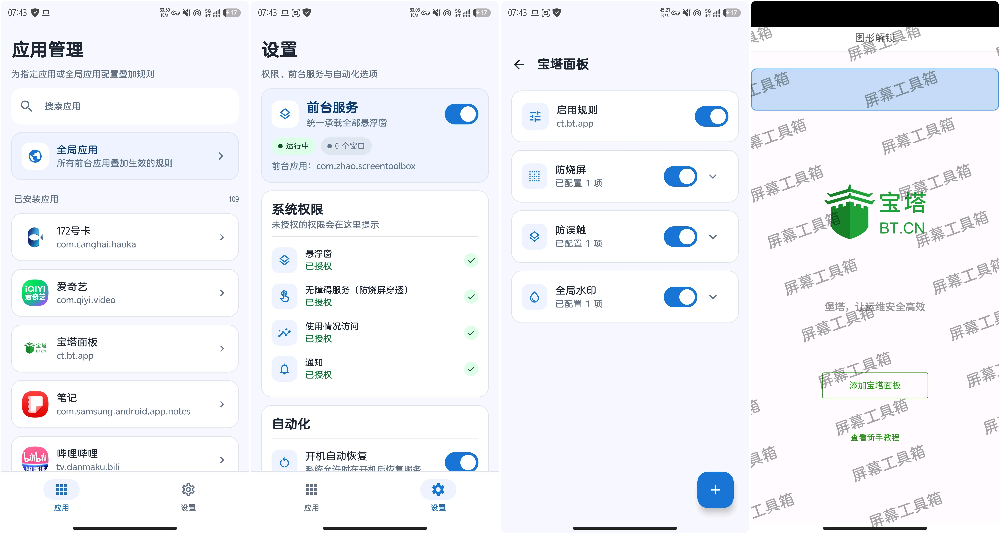

# ScreenToolbox

屏幕工具箱是 Android 8.0 及以上版本可运行的原生悬浮窗工具。应用使用 Kotlin、
Jetpack Compose、MVVM + Repository、Hilt、Room 和 DataStore 实现，不依赖 Root、
Shizuku 或云端服务。

## 项目预览



## 功能

- 防烧屏与防误触：新建和编辑共用可拖动、可最小化并自动吸附屏幕侧边的系统悬浮面板，支持宽高进度条、区域拖动和归一化坐标恢复。
- 防烧屏遮罩：通过无障碍服务创建受信任悬浮层，支持完全不透明显示和触摸穿透。
- 防误触：透明触摸拦截区域、边界提示、编辑手势和 30 秒临时解除。
- 全局水印：单条或平铺、颜色、字体、透明度、旋转和位置配置。
- 应用规则：从应用配置页直接添加防烧屏、防误触或水印配置，并按应用启用。
- 全局应用：配置始终叠加到应用专属规则上的全局规则，同类共享配置自动去重。
- 统一悬浮窗服务：前台通知、紧急关闭、拒绝重复窗口、权限撤销处理和服务恢复。
- 本地持久化：Room 保存配置与规则，DataStore 保存全局运行设置。

## 权限

- 悬浮窗权限：在系统设置中授权，用于显示所有系统窗口。
- 无障碍服务：用于承载完全不透明且允许触摸穿透的防烧屏遮罩，不读取窗口内容。
- 使用情况访问：用于识别当前前台应用，不上传使用记录。
- 通知权限：Android 13 及以上用于显示前台服务状态和紧急操作。
- 开机广播：仅在用户开启“开机自动恢复”后尝试恢复服务。

## 构建

环境要求：

- JDK 17
- Android SDK Platform 36
- Android Build Tools 36

```powershell
.\gradlew.bat :app:assembleDebug
.\gradlew.bat :app:testDebugUnitTest
.\gradlew.bat :app:lintDebug
.\gradlew.bat :app:connectedDebugAndroidTest
.\gradlew.bat :app:assembleRelease
```

Debug APK 由 Android Gradle Plugin 的标准输出目录生成。Release 构建已验证，但
正式发布前仍需配置用户自己的签名密钥。

## 架构边界

- Compose 只负责应用内 UI，System Overlay 使用 Android View + WindowManager。
- 防烧屏遮罩由 `AccessibilityService` 提供窗口宿主，其他悬浮窗使用普通应用悬浮层。
- `OverlayService` 是窗口运行态唯一所有者，`OverlayManager` 统一创建、更新、移除窗口。
- ViewModel 通过 `StateFlow` 暴露状态，不在 Composable 中执行业务逻辑。
- 数据库访问均经过 Repository；全局应用规则始终参与解析，匹配的普通应用规则随后叠加。
- 规则页面只展示当前应用或全局应用已绑定的配置，新增配置绑定失败时会回滚未完成数据。
- 旧版本未绑定任何规则的配置会保留在数据库中，但不再参与运行时窗口解析。

## 系统限制

- Android 12 及以上的不受信任触摸策略会限制非触摸悬浮窗的有效不透明度。
- 防烧屏遮罩依赖用户手动启用无障碍服务；服务关闭或异常断开时遮罩会自动移除。
- Android 15 及以上可能限制后台启动前台服务，开机恢复和厂商后台策略不保证成功。
- UsageStats 在多窗口、折叠屏和部分厂商系统上可能延迟或误判。
- 系统设置等受保护页面可能启用隐藏第三方悬浮窗的安全策略，此时编辑面板不会覆盖该页面。
- 普通应用无法任意更改其他应用的底层触摸分发，防误触只保证所创建透明窗口覆盖区域。
